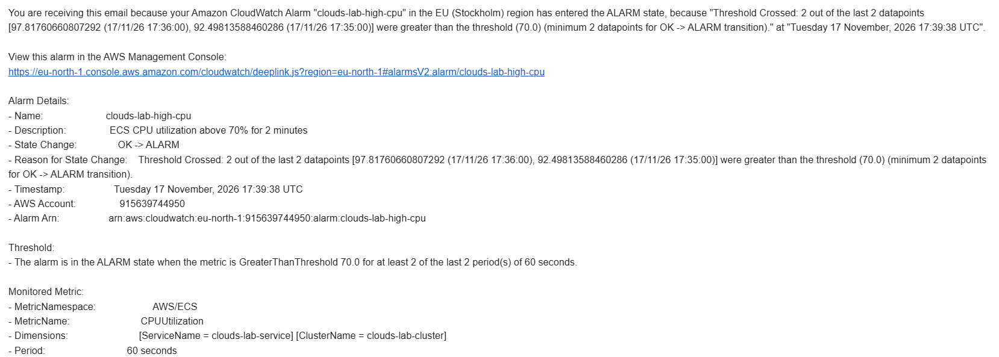
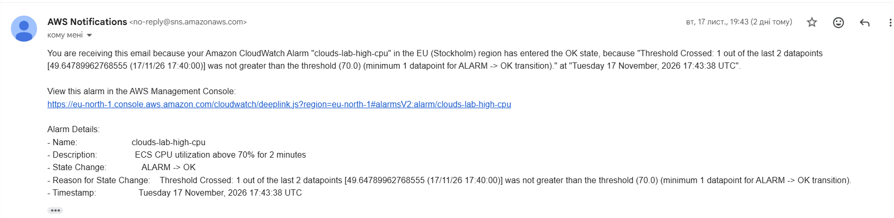
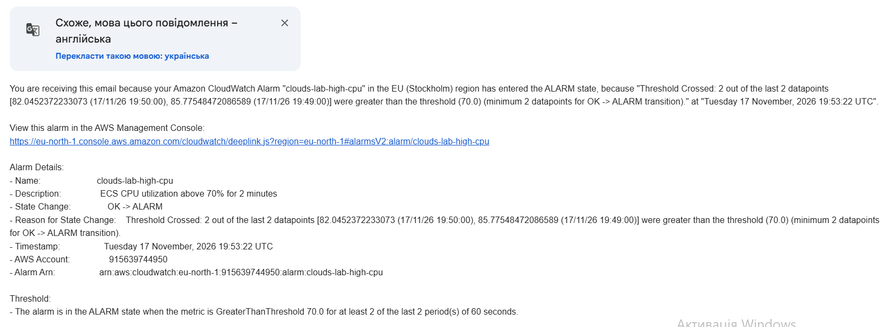
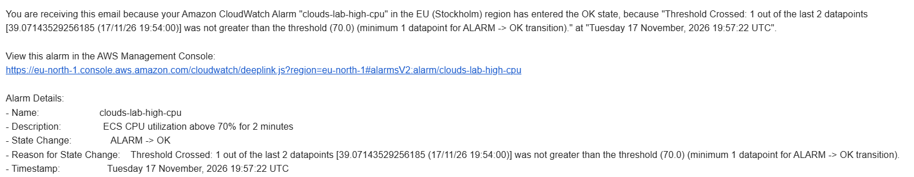

# Лабораторна робота №2 — сповіщення CloudWatch та SNS

## 1. Мета і реалізація

Для автоматичного інформування про перевантаження використано **Amazon CloudWatch Alarm** та **Amazon SNS**. Правило та підписку електронною поштою описано в `terraform/monitoring.tf` (`aws_cloudwatch_metric_alarm.high_cpu`, `aws_sns_topic.alerts`, `aws_sns_topic_subscription.email`). Після розгортання підписка SNS повинна бути підтверджена через лист.

## 2. Умова спрацьовування

| Параметр | Значення |
|---|---|
| Назва | `clouds-lab-high-cpu` |
| Сервіс | `AWS/ECS` |
| Метрика | `CPUUtilization` |
| Статистика | `Average` |
| Умова | **CPU > 70%** |
| Період | **60 секунд** |
| Кількість періодів | **2 із 2** |
| `ALARM` | Перевищення порогу протягом двох послідовних періодів |
| `OK` | Повернення вимірювань до норми |
| Доставка | Amazon SNS, протокол `email` |

Поріг **70%** обрано вище цілі автомасштабування **60%**: він сигналізує, що навантаження вже стало значним. Вимога двох періодів зменшує хибні спрацьовування від коротких піків CPU та нестабільне перемикання станів.

## 3. Результати тестування

### Без кешування

**Перехід `OK → ALARM`:** 17:39:38 UTC (**19:39:38 за Києвом**). У листі наведено дві точки CPU: **92,50%** (17:35 UTC) та **97,82%** (17:36 UTC).

Додатковий знімок `no_cache_ok.png` фіксує перехід **`ALERT → OK`** о **19:43:38 UTC**. Він підтверджує перехід `ALARM → OK`.

### З кешуванням

**Перехід `OK → ALARM`:** **19:53:22 UTC** (**21:53:22 за Києвом**). CPU на двох точках вимірювання — **85,78%** (19:49 UTC) та **82,05%** (19:50 UTC).

**Перехід `ALARM → OK`:** **19:57:22 UTC** (**21:57:22 за Києвом**). У повідомленні зафіксовано зниження CPU до **39,07%** (19:54 UTC).

Отже, під час тесту з кешем підтверджено **обидва необхідні переходи стану**: `OK → ALARM` і `ALARM → OK`.

## 4. Оцінка часу реакції

Сценарій k6 має 3 хвилини наростання і 5 хвилин сталого навантаження. За орієнтовним часом його початку:

| Тест | Початок сталої фази, приблизно (UTC) | Перехід у `ALARM` (UTC) | Час до `ALARM` |
|---|---|---|---|
| Без кешу | 17:36:03 | 17:39:38 | **≈ 3 хв 35 с** |
| З кешем | 19:49:29 | 19:53:22 | **≈ 3 хв 53 с** |

## 5. Висновок

У Terraform налаштовано CloudWatch Alarm із порогом **CPU > 70% протягом 2 хвилин** та надсиланням повідомлень через SNS. Під час тесту з та без кешування отримано докази переходів `OK → ALARM` і `ALARM → OK`.