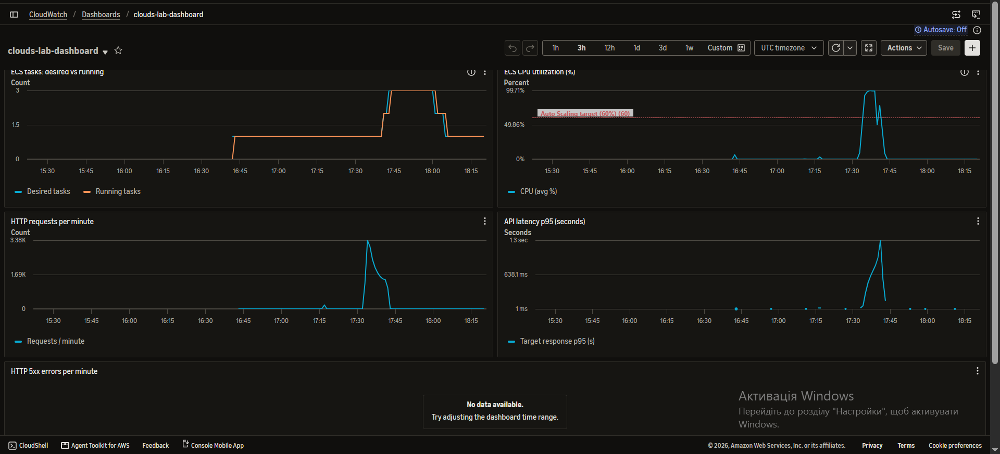
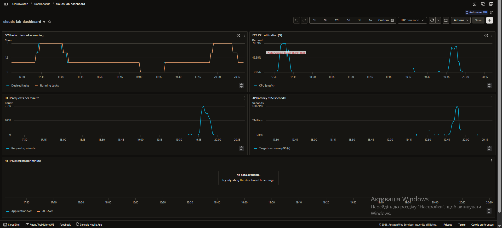

# Лабораторна робота №2 — автоматичне масштабування та моніторинг

## 1. Архітектура

REST API на Flask розгорнуто в **AWS ECS Fargate** за **Application Load Balancer (ALB)**. Дані зберігаються в **Amazon RDS MySQL**. Кількістю запущених ECS Tasks керує **AWS Application Auto Scaling**, а метрики виводяться на панель **Amazon CloudWatch**.

Конфігурацію описано у `terraform/autoscaling.tf`, `terraform/ecs.tf` та `terraform/monitoring.tf`.

## 2. Параметри масштабування

| Параметр | Значення | Обґрунтування |
|---|---|---|
| Тип | `TargetTrackingScaling` | Автоматично підтримує навантаження поблизу цільового значення |
| Метрика | `ECSServiceAverageCPUUtilization` | Доступна стандартна метрика використання CPU ECS |
| Цільове завантаження | **60%** | Залишає резерв CPU і дозволяє масштабуватися до перевантаження |
| Мінімум ECS Tasks | **1** | При низькому навантаженні працює один екземпляр |
| Максимум ECS Tasks | **3** | Відповідає обмеженню лабораторної та стримує витрати |
| Scale-out cooldown | **60 с** | Обмежує частоту повторних реакцій після збільшення кількості задач |
| Scale-in cooldown | **180 с** | Уникає швидкого вилучення задач за короткочасного спаду |

**Cooldown (період стабілізації)** — період, протягом якого політика враховує попередні зміни масштабування й стримує повторні дії. Якщо встановити cooldown рівним нулю, реакції на коливання метрик можуть бути надто частими: кількість задач постійно зростатиме та спадатиме, що підвищує витрати і нестабільність. Поведінка політики також залежить від правил CloudWatch та внутрішніх механізмів AWS.

Обрана метрика CPU зручна для демонстрації, однак у сервісі, що переважно очікує відповіді MySQL, вона не завжди відображає реальне навантаження. Альтернатива для такого API — `ALBRequestCountPerTarget` (кількість HTTP-запитів на ціль).

## 3. Панель CloudWatch

Панель `clouds-lab-dashboard`, описана в `terraform/monitoring.tf`, містить **п'ять графіків**:

1. `DesiredTaskCount` і `RunningTaskCount` — бажана та фактична кількість ECS Tasks.
2. `CPUUtilization` — середнє використання CPU; горизонтальна лінія показує ціль масштабування **60%**.
3. `RequestCount` — кількість HTTP-запитів за хвилину.
4. `TargetResponseTime` (`p95`) — 95-й перцентиль часу відповіді ALB-цілей.
5. `HTTPCode_Target_5XX_Count` та `HTTPCode_ELB_5XX_Count` — помилки застосунку та балансувальника класу 5xx.

### Без кешування

На графіках видно збільшення HTTP-навантаження, перевищення CPU-порогу та поступове зростання кількості Tasks від **1 до 3**. Після завершення навантаження кількість Tasks повернулася до **1**. За часовою шкалою знімка орієнтовні моменти: підйом CPU — **17:35–17:40 **, додавання задач — **17:43–17:46 **, повернення до одного екземпляра — **близько 18:05 ** (17 листопада 2026 року).

### З кешуванням

Повторний тест також показує різке зростання CPU, збільшення кількості Tasks до **3** та подальше зменшення до **1**. На одному знімку присутня історія попередніх станів інфраструктури; другий пік приблизно **19:49–19:56 **.

За результатами k6 обидва тести пройшли без HTTP-помилок. Графік 5xx показує `No data available`: це не доказ відсутності всіх можливих збоїв, але відповідає нульовій частці HTTP-помилок у виконаних k6-запитах.

## 4. Чому масштабування не миттєве

Після перевищення CPU-порогу потрібно отримати й агрегувати метрики CloudWatch, оцінити умову політики, змінити бажану кількість Tasks, завантажити/запустити новий контейнер та виконати healthcheck ALB. Тому між піком CPU та появою готової задачі минає кілька хвилин.

Вилучення задач відбувається повільніше, оскільки **scale-in cooldown — 180 с** (проти 60 с для scale-out). Крім того, AWS прагне уникати коливань кількості задач. При коректному зупиненні ECS/ALB припиняють спрямовувати нові запити на задачу, що виводиться з роботи, і дають час завершити поточні з'єднання згідно з налаштуваннями.

