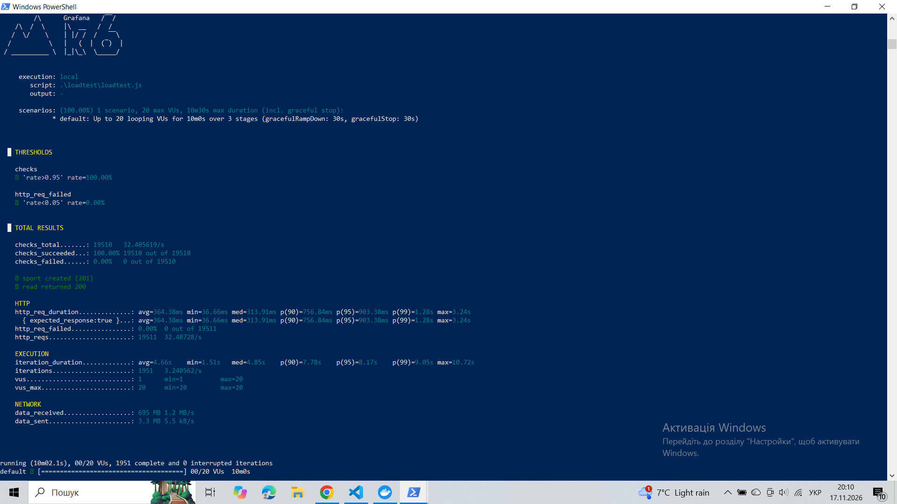
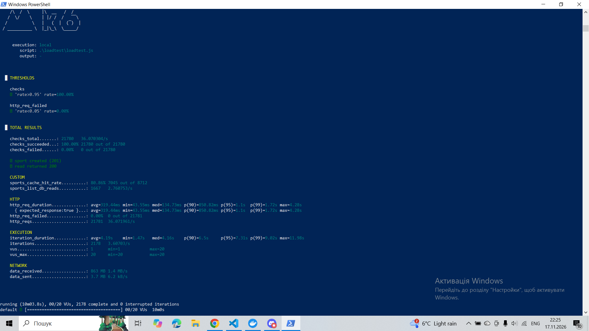

# Лабораторна робота №2 — кешування читань (cache-aside)

## 1. Мета

Зменшити кількість повторних читань з Amazon RDS MySQL для найбільш часто запитуваного маршруту Flask API та оцінити вплив кешування на пропускну здатність і затримки.

## 2. Реалізація

Кеш реалізовано **в пам'яті процесу Python**, без Redis. Кешується відповідь `GET /api/sports/` — список видів спорту.

- **Стратегія:** `cache-aside`.
- **TTL:** **45 секунд** (припустимий діапазон за завданням — 30–60 с).
- **Керування:** `SPORTS_CACHE_ENABLED=true/false` та `SPORTS_CACHE_TTL=45` у середовищі Flask-контейнера.
- **Діагностика:** HTTP-заголовок `X-Cache` зі значеннями `HIT`, `MISS` або `BYPASS`.
- **Інвалідація:** після успішних POST/PUT/DELETE для виду спорту.
- **Файли:** `project/my_project/utils/sports_cache.py`, `project/my_project/auth/route/sport_route.py`, `app.py`.

**Алгоритм:** при GET перевіряється наявність актуальних даних у локальному кеші. Якщо запис існує та TTL не минув — повертається `HIT`. Інакше дані читаються з MySQL, зберігаються у кеші на 45 секунд і повертаються з `MISS`. При вимкненому кеші читання виконується безпосередньо з MySQL (`BYPASS`).

## 3. Методика порівняння

Використано `loadtest/loadtest.js` у k6: **20 VU**, фази **3 + 5 + 2 хвилини** (разом 10 хв), в одній ітерації **1 POST і 9 GET**, зокрема **4 GET** на `/api/sports/`. Перед основними прогонами виконано 30-секундні підготовчі тести. Перед повторним тестом інфраструктуру розгорнуто заново, а початкове наповнення БД було приблизно однаковим.

Умови не є абсолютно ідентичними (БД змінюється під час тесту, а ECS масштабується), тому порівняння показує результат саме двох проведених прогонів, а не гарантований ефект для будь-якого навантаження.

## 4. Результати k6

| Метрика | Без кешу | З кешем | Зміна |
|---|---:|---:|---:|
| HTTP-запити | 19 511 | 21 781 | +11,6% |
| RPS | **32,41** | **36,07** | **+11,3%** |
| Середній час відповіді | 364,39 мс | 319,45 мс | −12,3% |
| p50 | **313,91 мс** | **134,73 мс** | **−57,1%** |
| p95 | **903,39 мс** | **1107,07 мс** | **+22,5%** |
| p99 | **1282,20 мс** | **1726,13 мс** | **+34,6%** |
| HTTP-помилки | 0% | 0% | Без змін |

**Без кешу:**

**З кешем:**

## 5. Влучання в кеш та навантаження на БД

У тесті з кешуванням чотири запити `GET /api/sports/` в кожній із **2178** ітерацій дають **8712** звернень до кешованого маршруту.

| Показник | Значення |
|---|---:|
| Звернення до `/api/sports/` з кешем | 8 712 |
| `X-Cache: HIT` | **7 045** |
| `X-Cache: MISS` / не `HIT` | **1 667** |
| Частка влучань (`HIT / усі звернення`) | **80,87%** |
| Орієнтовна кількість читань списку без кешу в першому тесті | **7 804** (`1951 × 4`) |
| Орієнтовна кількість читань списку з кешем у другому тесті | **1 667** |

Показник `sports_list_db_reads` у k6 — **оцінка за HTTP-заголовком `X-Cache`**, а не прямий вимір лічильників Amazon RDS. За співвідношенням HIT/MISS кеш дозволив уникнути приблизно **80,87%** потенційних читань MySQL саме для **списку видів спорту** в другому прогоні. Це **не** означає зниження загального навантаження на всю БД на 80,87%: POST-записи та інші GET продовжують працювати з MySQL.

## 6. Аналіз латентності

Пропускна здатність зросла приблизно на **11,3%**, середній час відповіді знизився на **12,3%**, а медіанна затримка — на **57,1%**.

Проте **p95 погіршився приблизно на 22,5%**, а **p99 — на 34,6%**. Можливі чинники: збільшена кількість запитів і записів, конкуренція за БД, окремі кеш-промахи, коливання мережевої затримки та моменти запуску ECS Tasks. Без окремих метрик RDS та деталізованих трасувань не можна точно визначити одну причину.

## 7. Застарілі дані та обмеження

**Максимальний типовий час застарівання — до 45 секунд** після зміни даних в іншому ECS Task, якщо там уже було заповнено незалежний кеш. У процесі, який виконав POST/PUT/DELETE, кеш очищається відразу; інші процеси про цю інвалідацію не знають.

Локальний кеш зберігається окремо в кожному процесі, тому при горизонтальному масштабуванні кілька ECS Tasks можуть одночасно повертати різні версії списку. Для зменшення неузгодженості можна зменшити TTL, але це збільшить частоту запитів до БД; кращий підхід — **спільний Redis** із централізованою інвалідацією після успішного запису.

Кеш також очищається після перезапуску процесу. Впроваджений `Lock` синхронізує потоки лише в межах одного процесу, а не між ECS Tasks. Для боротьби з одночасними промахами кешу на кількох екземплярах потрібен спільний механізм блокування або інша стратегія захисту.

## 8. Висновок

Реалізовано **cache-aside** для `GET /api/sports/` з **TTL 45 с**, діагностикою через `X-Cache` і локальною інвалідацією. За другим тестом частка влучань становила **80,87%**. Кеш покращив типову затримку й пропускну здатність, проте p95/p99 зросли. Для виробничої системи з кількома екземплярами рекомендовано спільний Redis та додатковий моніторинг RDS.
