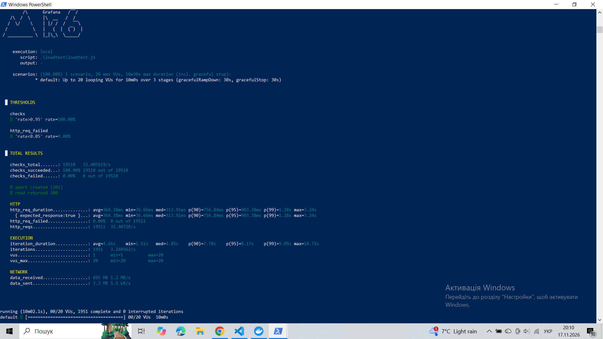
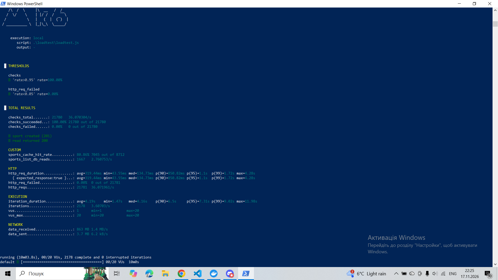

# Лабораторна робота №2 — навантажувальне тестування k6

## 1. Мета та інструмент

Перевірити роботу Flask API під навантаженням, зафіксувати продуктивність, поведінку ECS Auto Scaling і порівняти роботу з увімкненим та вимкненим кешуванням.

Інструмент: **Grafana k6**. Сценарій: `loadtest/loadtest.js`. Публічний API доступний через AWS Application Load Balancer.

## 2. Сценарій

Навантаження імітує профіль **«мало записів, багато читань»**. Кожна повна ітерація містить **10 HTTP-запитів**: **1 POST** (`/api/sports/`) для створення виду спорту та **9 GET** для отримання списку видів спорту, деталей щойно створеного запису, пов'язаних спортсменів, списку спортсменів і змагань. Серед дев'яти GET **чотири** звертаються до кешованого маршруту `/api/sports/`.

POST потребує JWT. Один запит `POST /api/auth/login` виконується в `setup()` перед запуском віртуальних користувачів, а його JWT використовується для записів у межах тесту.

| Фаза | Тривалість | Навантаження |
|---|---|---|
| Наростання | 3 хв | 0 → 20 VU |
| Стале навантаження | 5 хв | 20 VU |
| Спад | 2 хв | 20 → 0 VU |
| **Разом** | **10 хв** | |

Після кожної ітерації виконується `sleep(1)`. Порогові умови k6: менше **5%** HTTP-помилок та понад **95%** успішних перевірок.

## 3. Результати двох основних тестів

Проведено два десятихвилинні тести з **20 VU**: перший без кешування, другий з кешуванням. Перед основними прогонами виконувались короткі підготовчі тести; після повторного розгортання база мала приблизно однакову початкову кількість записів.

| Метрика | Без кешу | З кешем |
|---|---:|---:|
| HTTP-запити | **19 511** | **21 781** |
| Завершені ітерації | 1 951 | 2 178 |
| Успішні перевірки | 100% | 100% |
| HTTP-помилки | **0%** | **0%** |
| Запитів за секунду (RPS) | **32,41** | **36,07** |
| Середній час відповіді | 364,39 мс | 319,45 мс |
| p50 (медіана) | **313,91 мс** | **134,73 мс** |
| p95 | **903,39 мс** | **1107,07 мс** |
| p99 | **1282,20 мс** | **1726,13 мс** |

Результати взято з `loadtest/results/baseline.json` та `loadtest/results/with_cache.json`. Загальна кількість HTTP-запитів включає **один запит авторизації**, виконаний у `setup()`: `1951 × 10 + 1 = 19511` та `2178 × 10 + 1 = 21781`.

### Скріншоти результатів k6

**Без кешу:**

**З кешем:**

## 4. Масштабування та моніторинг

На панелі AWS CloudWatch під час тестів зафіксовано перехід ECS від **1** до **3** задач і подальше повернення до **1**. Пік CPU перевищував цільове значення масштабування **60%**. Див. [AUTOSCALING.md](AUTOSCALING.md) та знімки `no_cache_dashboard.png` і `cache_dashboard.png`.

## 5. Інтерпретація p50, p95, p99

- **p50** — половина запитів виконується не довше зазначеного часу.
- **p95** — 95% запитів виконуються не довше зазначеного часу; 5% — повільніші.
- **p99** — 99% запитів виконуються не довше зазначеного часу; 1% — повільніші.

Після увімкнення кешу RPS збільшився приблизно на **11,3%**, а p50 зменшився приблизно на **57,1%**. Водночас p95 і p99 **зросли**, тому не можна стверджувати, що кеш покращив час відповіді всіх запитів.

