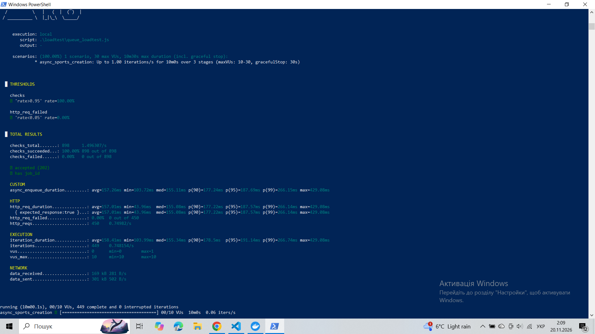
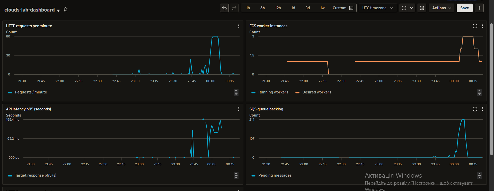

# Лабораторна робота №2 — завдання 6: асинхронна обробка через Amazon SQS

## 1. Мета та реалізована архітектура

Операцію створення виду спорту винесено з HTTP-обробника в асинхронну чергу **Amazon SQS**. Для цього додано `POST /api/jobs/sports` та окремий сервіс **Worker** в Amazon ECS Fargate. Синхронний `POST /api/sports/` залишено для звичайних операцій.

Послідовність виконання:

1. Клієнт із JWT надсилає дані нового `Sport` на `POST /api/jobs/sports`.
2. Flask перевіряє дані, створює запис `AsyncJob` у MySQL зі статусом `queued` і надсилає до SQS повідомлення з `job_id`.
3. API повертає **`202 Accepted`**, `job_id`, `status_url` і заголовок `Location`, не чекаючи завершення операції в MySQL.
4. Окремий Worker отримує повідомлення з SQS, знаходить завдання в MySQL, створює `Sport` та змінює статус на `completed`. Результат містить `sport_id`.
5. Клієнт отримує підсумок за `GET /api/jobs/{job_id}`. Можливі стани — `queued`, `completed` та `failed`.

Отже, **`202` підтверджує прийняття завдання, а не завершення запису**. Для перевірки фактичного результату клієнт звертається до `status_url`.

## 2. Компоненти проєкту

| Компонент | Реалізація | Призначення |
|---|---|---|
| API асинхронних операцій | `project/my_project/auth/route/job_route.py` | Приймання POST і перевірка стану job |
| Модель завдання | `project/my_project/auth/domain/async_job.py` | Збереження `payload`, `status`, `result` у MySQL |
| Worker | `worker.py` | Отримання SQS-повідомлень та виконання операції |
| Інфраструктура | `terraform/queue.tf` | SQS, DLQ, IAM, ECS Worker, CloudWatch alarms та Auto Scaling |
| Моніторинг | `terraform/monitoring.tf` | Графіки довжини черги, Worker tasks і затримки API |
| Функціональний тест | `loadtest/verify_bonus.ps1` | Перевірка створення, завершення job і відсутності дубліката |
| Навантажувальний тест | `loadtest/queue_loadtest.js` | Генерація асинхронних POST-запитів |

Для SQS налаштовано **visibility timeout 120 с**, **long polling 10 с** та **dead-letter queue (DLQ)** після трьох невдалих отримань повідомлення. Демонстраційний Worker має затримку `WORKER_DELAY_SECONDS=3`, щоб під навантаженням було видно накопичення повідомлень і реакцію масштабування.

## 3. Автоматичне масштабування Worker

У `terraform/queue.tf` задано діапазон **1–3 ECS tasks** та масштабування за метрикою SQS `ApproximateNumberOfMessagesVisible`:

| Подія | Умова | Дія | Cooldown |
|---|---|---|---|
| Scale-out | Щонайменше 10 повідомлень протягом двох періодів по 60 с | Додати 1 Worker task | 60 с |
| Scale-in | Не більше 2 повідомлень протягом трьох періодів по 60 с | Прибрати 1 Worker task | 180 с |

Масштабування не відбувається миттєво: CloudWatch спочатку накопичує метрики, потім спрацьовує alarm, а ECS запускає або зупиняє контейнери. `ApproximateNumberOfMessagesVisible` враховує повідомлення, що очікують у черзі, а не ті, які Worker уже обробляє.

## 4. Перевірка в AWS та результати

Реалізацію перевірено в розгорнутій AWS-інфраструктурі двома способами:

- **Функціональний тест:** `loadtest/verify_bonus.ps1` завершився успішно. API повернув `202` із `job_id`, Worker перевів завдання в `completed`, створений `Sport` став доступним через API. Цей тест також перевіряє ідемпотентність (див. [IDEMPOTENCY.md](IDEMPOTENCY.md)).
- **Навантажувальний тест:** `loadtest/queue_loadtest.js`, тривалість **10 хв**: 3 хв наростання до 1 POST/с, 5 хв стабільного навантаження, 2 хв спаду. Числові результати збережено в `loadtest/results/queue_summary.json`.

### Результати k6

| Метрика | Фактичний результат |
|---|---:|
| HTTP-запити (разом із авторизацією в `setup()`) | **450** |
| Асинхронні POST / завершені ітерації | **449** |
| Перевірки `accepted (202)` | **449 із 449** |
| Перевірки `has job_id` | **449 із 449** |
| Усі перевірки | **898 із 898 (100%)** |
| Частка HTTP-помилок | **0%** |
| Середній час HTTP-відповіді | **157,01 мс** |
| HTTP p50 / p95 / p99 | **155,08 / 187,57 / 266,14 мс** |
| Середній час `async_enqueue_duration` | **157,27 мс** |
| p95 `async_enqueue_duration` | **187,69 мс** |

Показник `async_enqueue_duration` відображає час відповіді на приймання завдання через HTTP, **не повний час виконання Worker**. k6 перевіряв `202` та наявність `job_id` для кожного асинхронного POST; масове завершення всіх 449 jobs окремо цим сценарієм не перевірялося.

### Поведінка SQS та ECS за CloudWatch

На збереженому графіку `qeue_dashboard.png` видно:

- накопичення повідомлень у SQS до **приблизно 214** та подальше спорожнення черги;
- зміну **бажаної** кількості Worker tasks з **1 до 3**, а після спадання навантаження — повернення до **1**; фактичне автоматичне масштабування Worker також було підтверджено під час тесту;
- затримку API на рівні сотень мілісекунд без тривалих секундних стрибків; підсумкове HTTP p95 у k6 становило **187,57 мс**.

Зі скриншота та k6 видно, що API швидко приймав завдання навіть за накопичення черги, а політика масштабування реагувала на backlog. Водночас це **не окреме порівняння з ненавантаженим API**: твердження про повну незмінність латентності потребувало б контрольного вимірювання до тесту.

## 5. Доставка «щонайменше один раз» і повторна обробка

Amazon SQS Standard підтримує доставку **at-least-once**: одне повідомлення може бути доставлене Worker повторно. Тому повторна доставка не повинна спричиняти повторне створення `Sport`.

У `worker.py` реалізовано захист: Worker отримує рядок `AsyncJob` з блокуванням **`SELECT ... FOR UPDATE`**, перевіряє його статус, а створення `Sport` і зміну статусу на `completed` виконує **в одній транзакції MySQL**. Якщо job уже має статус `completed` або `failed`, повторний `INSERT` не виконується. Після тимчасової помилки БД повідомлення не підтверджується та може бути доставлене повторно.

Таким чином, SQS гарантує повторні спроби доставки, а перевірка стану job та транзакція захищають від дублювання записів.

## 6. Обмеження та висновок

- Список `GET /api/sports/` використовує локальний cache-aside із TTL 45 с, тому новий `Sport` може з'явитися у списку не відразу; пряме звернення за `sport_id` не залежить від цього кешу.
- Демонстраційна затримка Worker у 3 с застосована лише для перевірки масштабування.

**Висновок:** асинхронне створення записів через Amazon SQS працює. Функціональний тест підтвердив завершення завдання й появу запису в MySQL, 10-хвилинний k6-тест — **449 успішно прийнятих асинхронних запитів без HTTP-помилок**, а AWS CloudWatch — накопичення та обробку черги й масштабування Worker за її довжиною.
