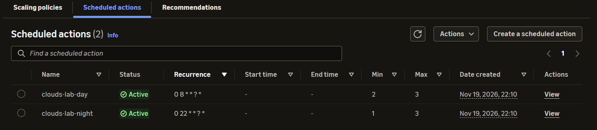

Модель за 30 днів, без додаткових спрацювань CPU Auto Scaling

| 2 екземпляри цілодобово | 2 вдень, 1 вночі |
|---|---|
| 1440 год | 1140 год |

Потенційна економія 20,8%

Розрахунок: 10 нічних годин × 30 днів = 300 зекономлених task-hours. Це економія відносно конфігурації з двома постійними екземплярами, а не порівняно з початковим мінімумом в один екземпляр.

Якщо використовувати орієнтовні тарифи AWS Fargate для Stockholm (0.0445/vCPU-год і 0.0049/GiB-год), економія становитиме близько $4,07 на місяць лише на обчислювальних ресурсах Fargate. Реальні витрати залежатимуть від тривалості роботи задач і додаткового масштабування.

## Розклад масштабування

Запис у форматі cron, який використовує AWS. Символи означають:
- 0 — нуль хвилин.
- 8 або 22 — година.
- "*" — будь-який день місяця.
- "*" — будь-який місяць.
- ? — день тижня не заданий окремо.
- "*" — будь-який рік.